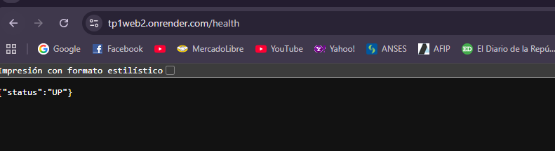
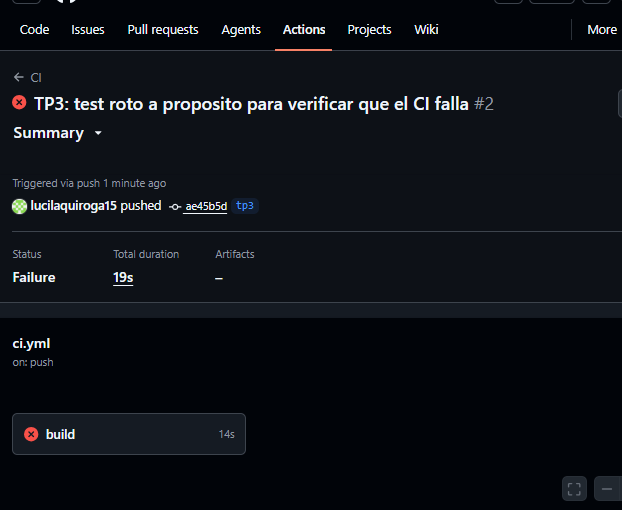
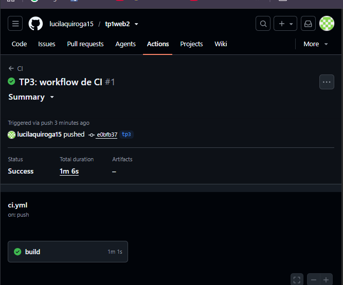
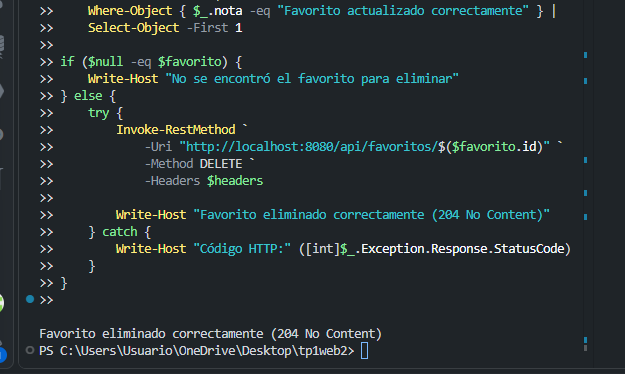
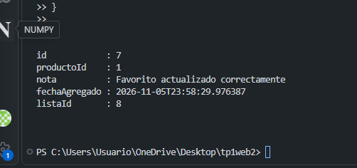
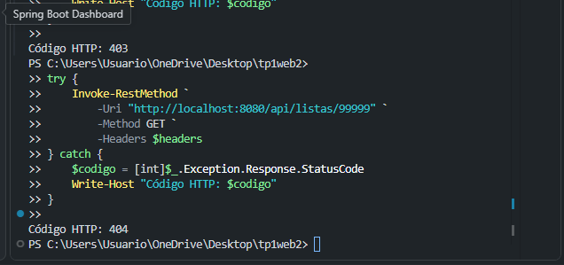
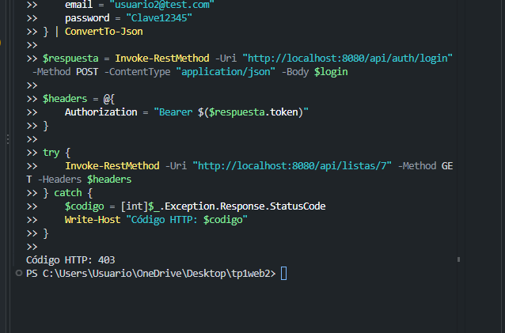
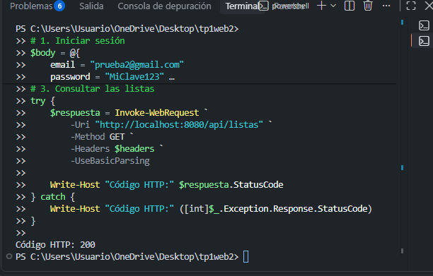
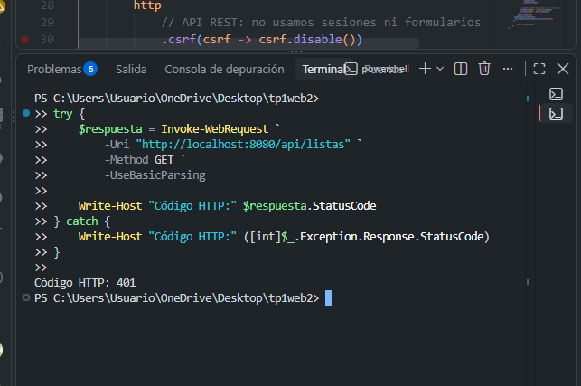

# TP2 · Persistencia, migraciones y arquitectura hexagonal

Evolución del proyecto del TP1 (Spring Boot, API REST y arquitectura en capas). Los favoritos dejan de guardarse en memoria y pasan a **PostgreSQL** con **Spring Data JPA / Hibernate**, el esquema se versiona con **Flyway**, se suma el recurso **Listas** (relación con favoritos) y se implementa una operación **transaccional**.

## 🛠️ Tecnologías

- Java 25
- Spring Boot 4.1.x
- Maven
- Spring Web MVC y Bean Validation
- Spring Data JPA / Hibernate
- PostgreSQL
- Flyway
- Springdoc OpenAPI / Swagger
- RestClient + API externa DummyJSON

## 🏗️ Arquitectura

```
Controller  →  Service  →  Puerto (interfaz Repository)
                                   ↑ implementa
                           Adapter (JPA)  →  PostgreSQL
```

El Service depende de un **puerto** (`FavoritoRepository`, `ListaRepository`): un contrato que solo habla en términos del dominio. La implementación concreta con JPA es un **adapter** que traduce entre los records del dominio y las entidades JPA.

## 🚀 Requisitos

- Java 25
- PostgreSQL (instalación local)

## 🐘 Cómo levantar PostgreSQL

Los datos de conexión que usa la aplicación (`application.properties`) son:

| Dato | Valor |
|---|---|
| Base | `tp2_web2` |
| Usuario | `webii_tp2` |
| Contraseña | `webii_tp2` |
| Puerto | `5432` |

### Opción A: Docker

```bash
docker compose up -d
```

### Opción B: instalación local

Con PostgreSQL instalado, en pgAdmin (Query Tool) o `psql`, ejecutar una sentencia por vez:

```sql
CREATE ROLE webii_tp2 WITH LOGIN PASSWORD 'webii_tp2';
```

```sql
CREATE DATABASE tp2_web2 OWNER webii_tp2;
```

## ▶️ Ejecución

```bash
./mvnw spring-boot:run
```

En Windows:

```bash
mvnw.cmd spring-boot:run
```

Queda disponible en `http://localhost:8080`:

- API: `/api/productos`, `/api/favoritos`, `/api/listas`
- Swagger UI: `http://localhost:8080/swagger-ui.html`

## 🗂️ Migraciones con Flyway

Flyway aplica automáticamente, al arrancar, las migraciones de `src/main/resources/db/migration`. Hibernate está en `ddl-auto=validate`: solo verifica que las entidades coincidan con el esquema, nunca lo modifica.

| Versión | Archivo | Qué hace |
|---|---|---|
| V1 | `V1__create_favoritos.sql` | Crea la tabla `favoritos` |
| V2 | `V2__create_listas.sql` | Crea la tabla `listas` |
| V3 | `V3__add_lista_id_a_favoritos.sql` | Agrega `lista_id` (con clave foránea) a `favoritos` |
| V4 | `V4__lista_id_obligatorio.sql` | Crea la lista "Sin clasificar", asigna los favoritos sin lista y hace `lista_id` `NOT NULL` |

**Cómo confirmar que corrieron:** en el log de arranque aparece `Successfully applied N migration(s)`, y la tabla que Flyway crea sola lo registra:

```sql
SELECT installed_rank, version, description, success
FROM flyway_schema_history
ORDER BY installed_rank;
```

## 📌 Endpoints

### Productos (solo lectura, espejo de DummyJSON)

```
GET /api/productos
GET /api/productos/{id}
```

### Favoritos

```
POST   /api/favoritos
GET    /api/favoritos
GET    /api/favoritos/{id}
PUT    /api/favoritos/{id}
DELETE /api/favoritos/{id}
```

Cada favorito pertenece a una lista (`listaId` obligatorio).

### Listas

| Operación | Método | Código de éxito |
|---|---|---|
| Crear lista | `POST /api/listas` | 201 Created |
| Listar listas | `GET /api/listas` | 200 OK |
| Obtener una lista | `GET /api/listas/{id}` | 200 OK |
| Favoritos de una lista | `GET /api/listas/{id}/favoritos` | 200 OK |
| Eliminar una lista vacía | `DELETE /api/listas/{id}` | 204 No Content |
| Mover favoritos a otra lista | `POST /api/listas/{origenId}/mover-favoritos` | 200 OK |

Errores: `400` por datos inválidos, `404` si un recurso no existe, `409` al borrar una lista con favoritos o al mover una lista sobre sí misma.

## 🔄 Qué cambió en la capa de persistencia (TP1 → TP2)

Al migrar los favoritos de memoria a JPA:

**Clases agregadas:** `FavoritoEntity`, `FavoritoJpaRepository` y `FavoritoRepositoryAdapter`.

**Clase eliminada:** `InMemoryFavoritoRepository`. Dos beans implementando `FavoritoRepository` hacen que Spring no sepa cuál inyectar.

**Clases que quedaron exactamente iguales:** `FavoritoRepository` (el puerto), el record de dominio `Favorito`, `FavoritoService`, `FavoritoController` y los DTOs de favoritos.

Esto fue posible porque `FavoritoRepository` es un **puerto**: el Service solo conoce el contrato (`buscarTodos`, `buscarPorId`, `save`, `deleteById`) y no sabe quién lo implementa. La versión en memoria del TP1 y `FavoritoRepositoryAdapter` son **adapters** intercambiables detrás de la misma interfaz, y cambiar de uno a otro no exige tocar nada de las capas superiores.

Después, al sumar Listas, `Favorito`, `FavoritoService`, los DTOs de favoritos y el puerto `FavoritoRepository` se modificaron para incorporar `listaId` y `buscarPorListaId`. Ese cambio se debe a una funcionalidad nueva, no al cambio de tecnología de persistencia.

## 🧬 Evolución del esquema: por qué V4 es una migración nueva

V1, V2 y V3 ya estaban aplicadas, y Flyway guarda un checksum de cada una en `flyway_schema_history`: si editara un archivo ya ejecutado, el checksum no coincidiría y la aplicación dejaría de arrancar, además de que otras bases que ya corrieron esa versión quedarían con un esquema distinto. Por eso la corrección se hizo con una migración nueva (V4), que se aplica una sola vez, en orden, y mantiene el historial idéntico en todas las bases.

## 🔒 Transacciones: por qué `mover-favoritos` es `@Transactional`

Mover los favoritos de una lista a otra son varias escrituras: reasignar cada favorito a la lista destino y, al final, eliminar la lista origen. Sin `@Transactional`, cada llamada al repository se confirma por separado (commit) apenas termina. Si una escritura fallara después de que otra ya se confirmó, el cambio anterior no se deshace, y la base queda a medio camino: por ejemplo, con parte de los favoritos ya en la lista destino y el resto todavía en la origen, o con todos los favoritos movidos pero la lista origen sin eliminar. Eso rompe la **atomicidad** de ACID (la operación debería aplicarse completa o no aplicarse) y deja datos inconsistentes, porque el resultado no corresponde ni al estado anterior ni al final esperado (**consistencia**). Con `@Transactional`, todas las escrituras forman una sola transacción: si cualquiera falla, se hace rollback de todas y la base queda exactamente como estaba, y los cambios recién se confirman, y se vuelven visibles para otros, cuando la operación terminó entera.

## 🧪 Evidencia

Casos de éxito y de error de cada recurso (incluida la operación de mover favoritos) en [`requests.http`](./requests.http), para usar con la extensión REST Client de VS Code. Ejecutarlo de arriba hacia abajo.


## 📖 Objetivos del TP

- Conectar una aplicación Spring Boot a PostgreSQL con Spring Data JPA.
- Reemplazar un repository en memoria por un adapter JPA sin tocar el dominio, el Service ni el Controller.
- Versionar el esquema con Flyway.
- Modelar una relación entre entidades y exponerla en la API.
- Delimitar una operación transaccional y justificarla en términos de atomicidad.
- Distinguir un puerto (contrato) de un adapter (implementación de infraestructura).


---

# TP3 — Seguridad, pruebas e integración continua

Este trabajo práctico continúa el desarrollo del TP2, incorporando autenticación mediante JWT, autorización por propietario y rol, pruebas automatizadas, integración continua y despliegue en la nube.

La aplicación mantiene su arquitectura basada en puertos y adaptadores, utilizando Java 25, Spring Boot, PostgreSQL y Flyway.

**Enlaces del proyecto:**

- **Repositorio:** https://github.com/lucilaquiroga15/tp1web2
- **API desplegada:** https://tp1web2.onrender.com
- **Swagger UI:** https://tp1web2.onrender.com/swagger-ui/index.html
- **Health:** https://tp1web2.onrender.com/health
- **GitHub Actions:** https://github.com/lucilaquiroga15/tp1web2/actions

## 1. Tecnologías incorporadas en el TP3

| Tecnología | Función |
|---|---|
| Java 25 | Lenguaje de programación |
| Spring Boot 4.1.x | Framework principal de la API |
| Spring Security | Autenticación y autorización |
| JWT | Autenticación mediante tokens |
| BCrypt | Protección de contraseñas |
| JUnit y Mockito | Pruebas unitarias |
| Testcontainers | Pruebas de integración con PostgreSQL |
| Maven Surefire y Failsafe | Ejecución de pruebas automatizadas |
| GitHub Actions | Integración continua |
| Docker | Contenedorización de la aplicación |
| Render | Despliegue de la API y PostgreSQL |

## 2. Seguridad, usuarios y JWT

Se incorporó Spring Security para proteger los recursos de la API mediante autenticación JWT y autorización según el usuario autenticado y su rol.

### 2.1. Registro de usuarios

**Endpoint público:**

`POST /api/auth/registro`

Cada usuario posee:

- `id`: identificador único.
- `email`: correo electrónico único.
- `passwordHash`: contraseña protegida mediante BCrypt.
- `rol`: `USER` o `ADMIN`.

Las contraseñas nunca se almacenan en texto plano. Antes de guardar un usuario, se genera un hash mediante BCrypt.

### 2.2. Inicio de sesión

**Endpoint público:**

`POST /api/auth/login`

El usuario envía su correo electrónico y contraseña.

Si las credenciales son válidas, la API devuelve un token JWT que permite acceder a los endpoints protegidos.

El token debe enviarse en la cabecera HTTP:

```http
Authorization: Bearer <token>
```

### 2.3. Autenticación y autorización

La API establece las siguientes reglas de acceso:

- **Productos:** acceso público.
- **Registro e inicio de sesión:** acceso público.
- **Health y Swagger:** acceso público.
- **Listas y favoritos:** requieren autenticación JWT.
- **USER:** puede acceder a sus propias listas y favoritos.
- **ADMIN:** puede acceder a recursos de otros usuarios según las reglas implementadas.

Cuando se crea una lista, queda asociada al usuario autenticado.

La propiedad de una lista no se determina mediante datos enviados por el cliente, sino mediante la identidad obtenida del token.

### 2.4. Códigos de respuesta HTTP

| Código | Significado |
|---|---|
| `200 OK` | Operación realizada correctamente |
| `201 Created` | Recurso creado correctamente |
| `204 No Content` | Operación exitosa sin contenido |
| `400 Bad Request` | Datos de entrada inválidos |
| `401 Unauthorized` | No se proporcionó un token válido |
| `403 Forbidden` | Usuario autenticado sin permisos suficientes |
| `404 Not Found` | Recurso inexistente |
| `409 Conflict` | Conflicto con una regla de negocio |

### 2.5. Justificación de la autorización en Service

La aplicación separa la autenticación de las reglas de autorización por propietario.

**Spring Security** se encarga de verificar la identidad del usuario mediante JWT y determinar qué endpoints requieren autenticación.

La **capa Service** comprueba si el usuario autenticado tiene permiso para operar sobre una lista o favorito.

Esta decisión se tomó porque la autorización por propietario forma parte de la lógica de negocio: requiere consultar el recurso y verificar a qué usuario pertenece.

Implementarla en Service permite:

- Evitar duplicar validaciones en los Controllers.
- Mantener la separación de responsabilidades.
- Aplicar las reglas independientemente del endpoint utilizado.
- Facilitar las pruebas unitarias.
- Respetar la arquitectura hexagonal del proyecto.

## 3. Migraciones de base de datos — Flyway

El TP3 incorpora dos migraciones adicionales a las cuatro desarrolladas durante el TP2.

Las migraciones se encuentran en:

`src/main/resources/db/migration`

| Versión | Descripción |
|---|---|
| V5 | Incorporación de usuarios, contraseñas hasheadas y roles |
| V6 | Incorporación de la relación de propiedad entre usuarios y listas |

Estas migraciones permiten almacenar los usuarios y asociar los recursos protegidos con sus propietarios.

Flyway ejecuta automáticamente las migraciones pendientes durante el inicio de la aplicación.

En el despliegue de Render se verificó que las seis migraciones fueron aplicadas correctamente, alcanzando la versión V6.

Las migraciones ya aplicadas no deben modificarse, ya que Flyway utiliza un historial de versiones y checksums para verificar su integridad.

## 4. Pruebas automatizadas

Se incorporaron pruebas automatizadas para verificar el funcionamiento de la lógica de negocio, la autenticación y las reglas de autorización.

### 4.1. Pruebas unitarias

Se utilizan JUnit y Mockito para probar los servicios de manera aislada.

Los escenarios contemplados incluyen:

- Comprobar que una lista nueva quede asociada al usuario autenticado.
- Verificar que las contraseñas no se almacenen en texto plano.
- Verificar las restricciones de acceso a listas ajenas.
- Comprobar los permisos correspondientes al rol ADMIN.

Las pruebas unitarias utilizan la convención de nombres `*Test`.

### 4.2. Pruebas de integración

Se utiliza Testcontainers para ejecutar PostgreSQL en un contenedor Docker durante las pruebas.

Esto permite verificar el funcionamiento de la aplicación con una base de datos real y las migraciones de Flyway.

Los escenarios de integración incluyen:

| Escenario | Resultado esperado |
|---|---|
| Login con credenciales válidas | `200 OK` y JWT |
| Login con credenciales inválidas | `401 Unauthorized` |
| Consulta de lista propia | `200 OK` |
| Consulta de lista ajena | `403 Forbidden` |
| Consulta de listas sin token | `401 Unauthorized` |
| ADMIN accede a una lista ajena | `200 OK` |

Las pruebas de integración utilizan la convención `*IT`.

### 4.3. Ejecución de las pruebas

Para ejecutar las pruebas unitarias desde Windows PowerShell:

```powershell
.\mvnw.cmd test
```

Para ejecutar todas las pruebas mediante Maven Verify:

```powershell
.\mvnw.cmd verify
```

En Linux o macOS:

```bash
./mvnw verify
```

**Importante:** Docker Desktop debe estar funcionando para ejecutar las pruebas de integración que utilizan Testcontainers.

Maven Surefire ejecuta las pruebas unitarias y Maven Failsafe las pruebas de integración durante la fase `verify`.

## 5. Integración continua — GitHub Actions

El proyecto utiliza GitHub Actions para automatizar la compilación y ejecución de pruebas.

El workflow se encuentra en:

`.github/workflows/ci.yml`

En cada ejecución configurada, GitHub Actions prepara un entorno con Java 25 y ejecuta:

```bash
./mvnw verify
```

Este proceso permite detectar errores antes de continuar con el desarrollo o despliegue.

### 5.1. Verificación de una ejecución fallida

Se introdujo temporalmente un error para comprobar que GitHub Actions detectara correctamente una ejecución fallida.

El workflow finalizó con estado **Failure**.

### 5.2. Verificación de una ejecución exitosa

Luego de corregir el error, se ejecutó nuevamente el workflow.

GitHub Actions finalizó con estado **Success**, confirmando que el proyecto superó las verificaciones automatizadas.

Las ejecuciones pueden consultarse en:

https://github.com/lucilaquiroga15/tp1web2/actions

## 6. Despliegue en Render

La aplicación fue desplegada en Render utilizando Docker y PostgreSQL.

### 6.1. Configuración realizada

1. Se creó una base de datos PostgreSQL en Render denominada `tp1web2-db`.
2. Se creó un Web Service denominado `tp1web2`.
3. Se conectó el servicio al repositorio de GitHub.
4. Se configuró el despliegue mediante el Dockerfile del proyecto.
5. Se agregaron las variables de entorno necesarias.
6. Se verificó el inicio correcto de Spring Boot.
7. Se confirmó la ejecución de las seis migraciones de Flyway.
8. Se realizaron pruebas sobre la API publicada.

### 6.2. Variables de entorno

| Variable | Descripción |
|---|---|
| `DB_URL` | URL JDBC de PostgreSQL |
| `DB_USERNAME` | Usuario de la base de datos |
| `DB_PASSWORD` | Contraseña de PostgreSQL |
| `JWT_SECRET` | Clave secreta para firmar los tokens |
| `JWT_EXPIRATION_MS` | Duración del JWT en milisegundos |
| `PORT` | Puerto asignado por el proveedor |

Las credenciales y claves secretas se configuran en Render y no deben publicarse en el repositorio.

### 6.3. Verificación en producción

Se realizaron las siguientes comprobaciones:

| Verificación | Resultado |
|---|---|
| Estado del servicio | Live |
| `GET /health` | `200 OK` |
| Respuesta de Health | `{"status":"UP"}` |
| Migraciones Flyway | V1 a V6 aplicadas |
| Registro de usuario | `201 Created` |
| Login válido | `200 OK` |
| Consulta de listas sin JWT | `401 Unauthorized` |
| Consulta de listas con JWT | `200 OK` |

**URL pública:** https://tp1web2.onrender.com

**Swagger:** https://tp1web2.onrender.com/swagger-ui/index.html

El despliegue demuestra que la aplicación puede funcionar fuera del entorno local, conectada a PostgreSQL y con autenticación JWT habilitada.

Al utilizar el plan gratuito de Render, el servicio puede suspenderse por inactividad y demorar en responder a la primera solicitud.

## 7. Evidencias del TP3

A continuación se presentan las capturas que documentan el funcionamiento de la aplicación, las reglas de seguridad, las pruebas y el despliegue.

### 7.1. Verificación del despliegue — Health

Se comprobó que el endpoint público `/health` responde correctamente desde Render.



### 7.2. Integración continua — Ejecución fallida

Se introdujo temporalmente un error para verificar que GitHub Actions detectara el fallo.



### 7.3. Integración continua — Ejecución exitosa

Después de corregir el error, el workflow finalizó correctamente.



### 7.4. Eliminación de un favorito

Se ejecutó una solicitud `DELETE` y se obtuvo `204 No Content`, confirmando la eliminación.



### 7.5. Consulta de favorito actualizado

Se verificó que el favorito contiene los datos actualizados.



### 7.6. Autorización y manejo de errores

Se verificaron las respuestas `403 Forbidden` para un acceso no permitido y `404 Not Found` para un recurso inexistente.



### 7.7. Acceso a una lista ajena

Se comprobó que un usuario autenticado no puede consultar una lista perteneciente a otro usuario.

La API respondió `403 Forbidden`.



### 7.8. Acceso autenticado a listas

Se ejecutó una solicitud `GET /api/listas` con autenticación válida y se obtuvo `200 OK`.



### 7.9. Acceso sin autenticación

Se ejecutó una solicitud `GET /api/listas` sin JWT.

La API respondió `401 Unauthorized`, confirmando que el endpoint está protegido.



## 8. Conclusión del TP3

El TP3 permitió evolucionar la aplicación incorporando mecanismos de seguridad, autenticación y autorización.

Se implementó autenticación mediante JWT, almacenamiento seguro de contraseñas con BCrypt y restricciones de acceso según el usuario y su rol.

También se incorporaron pruebas automatizadas, integración continua mediante GitHub Actions y despliegue en Render con PostgreSQL.

Las evidencias permiten comprobar el funcionamiento de los endpoints, las restricciones de seguridad, las respuestas HTTP y la ejecución del workflow de integración continua.

De esta manera, el proyecto integra persistencia, arquitectura hexagonal, seguridad, pruebas y despliegue en una misma API REST.